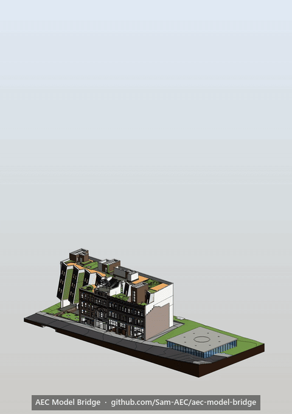
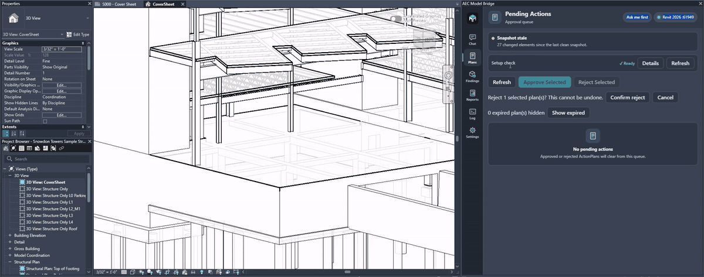
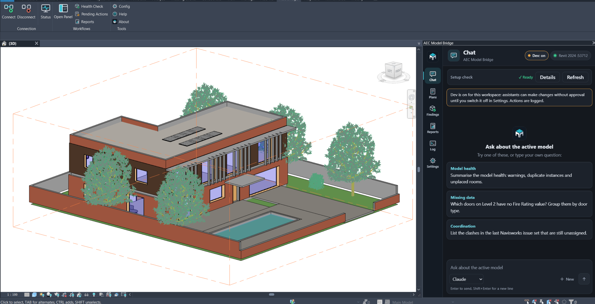
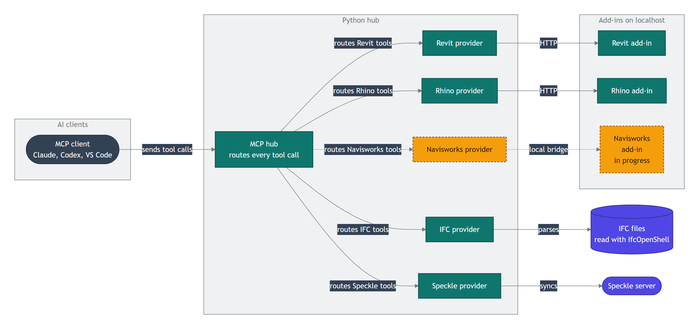
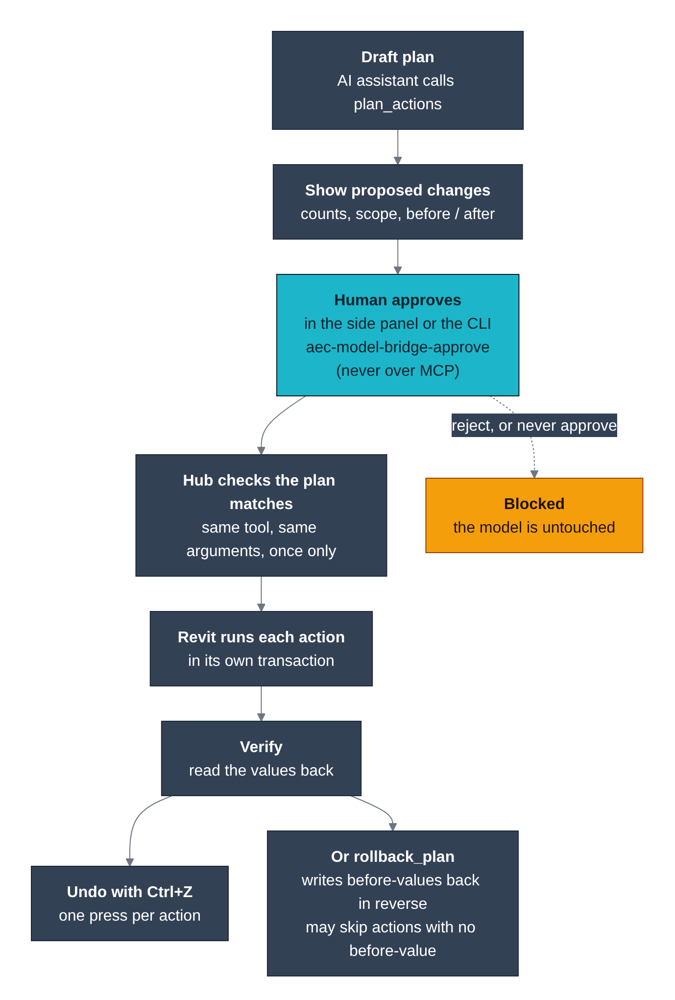

<div align="center">


**English** | [简体中文](docs/i18n/README.zh-CN.md) | [Español](docs/i18n/README.es.md) | [हिन्दी](docs/i18n/README.hi.md) | [العربية](docs/i18n/README.ar.md) | [Português (BR)](docs/i18n/README.pt-BR.md) | [Русский](docs/i18n/README.ru.md) | [日本語](docs/i18n/README.ja.md) | [Deutsch](docs/i18n/README.de.md) | [Français](docs/i18n/README.fr.md) | [Bahasa Indonesia](docs/i18n/README.id.md) | [Türkçe](docs/i18n/README.tr.md) | [한국어](docs/i18n/README.ko.md) | [Tiếng Việt](docs/i18n/README.vi.md) | [Italiano](docs/i18n/README.it.md) | [Polski](docs/i18n/README.pl.md) | [繁體中文](docs/i18n/README.zh-TW.md)

# AI for Revit you can trust

**AI assistants read the Revit model you have open. By default, nothing in it changes until you approve a plan.**

Open-source Revit MCP server · Revit 2024 – 2027 · 317 tools · Claude, Codex, Cursor and other MCP clients

[](https://github.com/Sam-AEC/aec-model-bridge/actions/workflows/ci.yml)
[](https://github.com/Sam-AEC/aec-model-bridge/releases/latest)
[](packages/mcp-server-revit/pyproject.toml)
[](#supported-revit-versions)
[](LICENSING.md)
[](https://scorecard.dev/viewer/?uri=github.com/Sam-AEC/aec-model-bridge)

[Get started](#quick-start) | [Example workflows](#example-workflows) | [Tools](docs/tools-generated.md) | [Documentation](#documentation) | [Download](https://github.com/Sam-AEC/aec-model-bridge/releases/latest)

<a href="docs/images/readme/revit-tower.mp4"></a>

<sub>Dev mode, Revit 2026.5: 30 floors of slabs, core, columns and curtain wall placed through <code>revit_execute_python</code>. Every frame was rendered by Revit. [Watch the MP4](docs/images/readme/revit-tower.mp4).</sub>

<a href="docs/images/readme/revit-live.mp4"></a>

<sub>Screen recording of Revit 2026.5 on the Autodesk Snowdon Towers sample, not edited beyond cuts. [Watch the MP4](docs/images/readme/revit-live.mp4).</sub>

</div>

**Pre-release (1.6.0).** See [status and limits](#status-and-limits).

<p align="center">
  
</p>

AEC Model Bridge is an open-source Revit MCP server with a native Revit
add-in. AI assistants use it to read your open model and propose edits.

- **Reads run straight away.** Warnings, elements, parameters, sheets, views.
- **Writes wait for you.** The assistant drafts a plan with `plan_actions`. You
  review it in the Revit panel. `execute_plan` applies it only after you approve.
- **Every executed plan leaves a proof file** that can seed a revert plan, which
  you approve the same way.
- **No Revit here?** Mock mode returns sample data. [Try it in 60 seconds](#quick-start).

It is for BIM coordinators and managers who want an assistant to check model
quality and prepare parameter fixes while a person approves every change. You
do not need to write scripts.

<a id="status-and-limits"></a>
**Status and limits.** Try it on a copy of a project first: approving a plan
changes the open model.

- Verified live: bounded read-only checks in Revit 2024
  ([report](docs/revit-addin-live-validation-2026-10-14.md)).
- Not verified live: writes, rollback, recovery, and Revit 2025 to 2027. CI does
  not start Revit. See the [release checklist](docs/release-checklist.md).
- This page follows the development branch. The latest release may differ.

Setup is documented for Claude Desktop, VS Code with GitHub Copilot, Cursor and
Codex ([compatibility](docs/compatibility.md)). The server also handles IFC,
Rhino, Grasshopper and Speckle ([integrations](#other-integrations)).

## Star History

<a href="https://www.star-history.com/?repos=sam-aec%2Faec-model-bridge&type=date&legend=top-right">
  
</a>

## Example workflows

| Workflow | Example request | Tools used |
| --- | --- | --- |
| Model review | "List the active document's warnings and find affected elements." | `revit_get_document_info`, `revit_get_warnings`, `revit_get_elements_by_type` |
| Parameter updates | "Find walls on Level 02 and propose a batch update of Comments." | `revit_get_elements_by_type`, `revit_get_element_parameters`, `revit_batch_set_parameters` |
| Drawing production | "Create sheets from this CSV and place the views." | `revit_batch_create_sheets_from_csv`, `revit_place_viewport_on_sheet` |
| IFC review | "Show this IFC file's storeys and report schema validation issues." | `ifc_get_spatial_structure`, `ifc_get_properties`, `ifc_validate` |

For a first run in Revit, try:

```text
Read the active model's warnings. Group them by description and show the
affected element IDs. Then suggest which issues to investigate first.
```

Then try a parameter correction, replacing the level and value for your project:

```text
Find walls on Level 02 and show their current Comments values. Propose setting
Comments to "Coordination reviewed" for the elements I choose. After I approve
the plan in Revit, apply it and read the values back to confirm the result.
```

IFC review runs without Revit.

Snapshot QA/QC and report modules need a compatible saved snapshot, and the
filename and workspace must match. Always pass `snapshot_id`: without it most
modules refuse in bridge mode and return sample data in mock mode
(`model_bloat` does not yet). For live inspection,
use the direct Revit tools above.

## Quick start

**In 60 seconds, without Revit (mock mode)**

1. Install [uv](https://docs.astral.sh/uv/getting-started/installation/).
2. Add the server to your client with the JSON under Manual setup and set
   `"MCP_REVIT_MODE": "mock"`. The one-click buttons below use `bridge` mode,
   which needs Revit.
3. Restart the client and ask it to list the tools, then read the active
   document. Mock mode returns generated sample data, never your model.
4. For your own model, [install the Revit add-in](#install-the-revit-add-in) and
   switch the mode to `bridge`.

**One-click install**

[](docs/install.md#vs-code)
[](https://cursor.com/en/install-mcp?name=aec-model-bridge&config=eyJjb21tYW5kIjoidXZ4IiwiYXJncyI6WyItLWZyb20iLCJnaXQraHR0cHM6Ly9naXRodWIuY29tL1NhbS1BRUMvYWVjLW1vZGVsLWJyaWRnZSNzdWJkaXJlY3Rvcnk9cGFja2FnZXMvbWNwLXNlcnZlci1yZXZpdCIsImFlYy1tb2RlbC1icmlkZ2UiXSwiZW52Ijp7Ik1DUF9SRVZJVF9NT0RFIjoiYnJpZGdlIn19)
[](https://github.com/Sam-AEC/aec-model-bridge/releases/latest)

The buttons need only uv. The workspace is `~/Documents/AEC Model Bridge`
unless you set your own. For Claude Desktop, open the `.mcpb` file from the
latest release. Live Revit work also needs [the add-in](#install-the-revit-add-in).

**Manual setup**

Live Revit automation needs Windows, a licensed Revit 2024 to 2027, Python 3.11
or newer, uv and the [add-in](#install-the-revit-add-in). Add this to
`claude_desktop_config.json` (Codex, Cursor and VS Code use the same values).
The two directory variables are optional and default to the workspace above.

```json
{
  "mcpServers": {
    "aec-model-bridge": {
      "command": "uvx",
      "args": [
        "--from",
        "git+https://github.com/Sam-AEC/aec-model-bridge#subdirectory=packages/mcp-server-revit",
        "aec-model-bridge"
      ],
      "env": {
        "MCP_REVIT_MODE": "bridge",
        "MCP_REVIT_WORKSPACE_DIR": "C:\\RevitProjects",
        "MCP_REVIT_ALLOWED_DIRECTORIES": "C:\\RevitProjects"
      }
    }
  }
}
```

Set `"MCP_REVIT_MODE": "mock"` to list every tool and its schema without
touching a model. A root `Dockerfile` runs mock mode:
`docker build -t aec-model-bridge .`, then `docker run -i --rm aec-model-bridge`.

The [VS Code extension](packages/vscode-extension/README.md) shows connection
status. It is not on the Marketplace.

### Tools at a glance

| Area | Tools | What they do |
| --- | --- | --- |
| Revit | 112 | Read the model, edit elements, parameters, views, sheets, schedules, exports, worksharing |
| Approval | 6 | Plan, review, approve, execute and roll back changes; show the workspace policy |
| Modules | 117 | Snapshot inspection, parameter grids, QA/QC checks, recipes, reports, selections |
| Rhino and Grasshopper | 19 | Geometry, layers, materials, boolean operations |
| Speckle | 17 | Projects, models, versions, send and receive |
| Navisworks | 15 | Model tree, viewpoints, clash tests (in progress) |
| IFC | 7 | Read IFC files without Revit |
| Graph, snapshots, exports, jobs | 24 | Graph audits, snapshot diffs, SQLite export, background jobs |

317 tools are listed in the default setup (counted from the current server in
mock mode). Autodesk Data tools appear when APS credentials are configured. The
[tool reference](docs/tools-generated.md) lists every tool. Each tool carries
MCP annotations (`readOnlyHint`, `destructiveHint`, `idempotentHint`,
`openWorldHint`), so clients can tell reads from writes.

### Advanced Revit automation

For anything the catalog does not cover, `revit_invoke_method`,
`revit_reflect_get` and `revit_reflect_set` work with public Revit API members,
and `revit_execute_python` runs IronPython inside Revit. They have the same
permissions as the Revit process. Use them only with clients and prompts you
trust.

## How it works

The MCP client talks to one Python hub, which routes each call to the provider
that owns the tool. Desktop providers talk to an add-in inside the app over
localhost.

<p align="center">
  <picture>
    <source media="(prefers-color-scheme: dark)" srcset="docs/images/architecture-dark.png">
    
  </picture>
</p>

<sub>Diagram source: [architecture.mmd](docs/diagrams/architecture.mmd). Regenerate the images with `python scripts/render_diagrams.py`. Teal boxes work today, amber dashed boxes are in progress, indigo shapes are external services.</sub>

### How approval works

- **Two modes you will use.** `look_only` lets the assistant read and refuses
  every tool that changes the model. `ask_first` (the default, also written
  `required`) lets it draft changes, but nothing runs until a person approves.
  `auto` switches the check off, for controlled pipelines only
  (`MCP_REVIT_APPROVAL_MODE=auto`).
- **Only a person approves.** Approving, rejecting and rolling back plans are
  not offered to AI clients. Approve in the Revit panel or with the
  `aec-model-bridge-approve` command.
- **Nothing applies on its own.** A change runs once, and only if it matches an
  approved action of an approved plan.

<p align="center">
  <picture>
    <source media="(prefers-color-scheme: dark)" srcset="docs/images/approval-flow-dark.png">
    
  </picture>
</p>

<sub>Diagram source: [approval-flow.mmd](docs/diagrams/approval-flow.mmd).</sub>

The panel's Plans list shows each pending plan's tools, arguments and, when
captured, the before-value. Review text (reasoning, citations, assumptions,
warnings) must be opened before Approve is enabled. Malformed, unsupported or
oversized reviews block approval. If the panel cannot show a plan completely, it
disables Approve and points to `aec-model-bridge-approve show <plan_id>`, which
works for a plan in any state. See
[plan review in the panel](docs/security.md#plan-review-in-the-panel). Live
WebView2 approval still needs acceptance.

**Undo.** Parameter and model-edit actions each run in their own named
transaction, so Ctrl+Z undoes one action per press. Save, sync and scripts are
not covered. If every action of a plan is a parameter write, move or rotation and
the add-in lists `revit.execute_plan_batch`, the plan runs as one transaction
group named "AEC Model Bridge: <plan title> (<short id>)". One press undoes it,
and one failed action rolls the whole group back.

**Revert.** The assistant can draft a revert plan with `plan_revert` from the
proof of an executed plan, and you approve it like any other plan.
`rollback_plan` writes recorded before-values back in reverse order. It is for
people only and has no panel button or command yet, so do not count on it.
File output and other irreversible operations are not undone and get no second
confirmation yet (planned). No undo or revert path is verified in a live Revit
session (UNVERIFIED). `proofs/` bundles exist only for plans that were executed
or attempted. See [ADR 0008](docs/adr/0008-approval-gate-lifecycle.md).

## Supported Revit versions

| Revit version | Add-in target | Build tools |
|---|---|---|
| 2024 | .NET Framework 4.8 | .NET 8 SDK and .NET Framework 4.8 developer pack |
| 2025 | .NET 8 for Windows | .NET 8 SDK |
| 2026 | .NET 8 for Windows | .NET 8 SDK |
| 2027 | .NET 10 for Windows | .NET 10 SDK |

CI compiles the add-in for all four years, but no year is verified in a live
Revit session. You also need Windows 10 or 11, Python 3.11 or later, and a
licensed Revit. Mock mode runs without Revit.

### Other integrations

| Integration | Status |
|---|---|
| Revit | Available. Native C# add-in. |
| IFC (IfcOpenShell) | Available. Reads IFC files without Revit. |
| Rhino and Grasshopper | Available. Connects to the Rhino add-in on `localhost:3004`. |
| Speckle | Available. Needs a Speckle client ID in your environment. |
| Navisworks Manage | In progress. Provider and tools are registered; the add-in is not finished. |
| Power BI | In progress. Provider and tool exist but are not registered in the hub. |
| Excel, Parquet and DuckDB | Planned. |

Product names and logos belong to their owners.

## Install the Revit add-in

**Easiest (Windows):** download `AECModelBridge-Setup-<version>.exe` from the
[latest release](https://github.com/Sam-AEC/aec-model-bridge/releases/latest),
run it, pick your Revit versions and restart Revit. It installs the add-in and
the bundled Python server. If you tick the box, it also sets up Claude Desktop
and VS Code after backing up your settings. Uninstall from Windows Settings. The steps below build from source.

### 1. Install the MCP server

To run the server without a clone, use `uvx` as in [Manual setup](#quick-start)
or the [install guide](docs/install.md#run-the-server-with-uvx). The short
`uvx aec-model-bridge` form needs a PyPI release, which does not exist yet. To
work on the source:

```powershell
git clone https://github.com/Sam-AEC/aec-model-bridge.git
cd aec-model-bridge

py -m venv .venv
.\.venv\Scripts\Activate.ps1
python -m pip install -e packages/mcp-server-revit
```

### 2. Install the Revit add-in

If Windows blocks the downloaded scripts, right-click each `.ps1` file, open
Properties, and select Unblock.

```powershell
$RevitVersion = Read-Host "Revit year (2024, 2025, 2026, or 2027)"

.\scripts\package.ps1 -RevitVersion $RevitVersion
.\scripts\install.ps1 -RevitVersion $RevitVersion
```

The installer places version-specific binaries in:

```text
C:\ProgramData\AECModelBridge\bin\<year>
```

The add-in manifest is installed per user in:

```text
%APPDATA%\Autodesk\Revit\Addins\<year>
```

Add `-AllUsers` to `install.ps1` to use
`C:\ProgramData\Autodesk\Revit\Addins\<year>` instead. To prepare every
supported version:

```powershell
.\scripts\package.ps1 -RevitVersion All
```

Each [release](https://github.com/Sam-AEC/aec-model-bridge/releases/latest)
has a package per Revit year, for example `aec-model-bridge-revit-2026-<version>.zip`.
Unzip it and run `.\install.ps1 -RevitVersion 2026` instead of building.
`scripts/build-installer.ps1` builds an Inno Setup installer. Troubleshooting is
in [docs/install.md](docs/install.md).

## Connect Claude Desktop to Revit

Add the server to the `mcpServers` section of `claude_desktop_config.json`.
Codex, Cursor, VS Code and other MCP clients use the same `command`, `args` and
`env` values in their own format. Use the Python from your virtual environment
and a workspace folder the server may access:

```json
{
  "mcpServers": {
    "aec-model-bridge": {
      "command": "C:\\path\\to\\aec-model-bridge\\.venv\\Scripts\\python.exe",
      "args": ["-m", "revit_mcp_server.mcp_server"],
      "env": {
        "MCP_REVIT_MODE": "bridge",
        "MCP_REVIT_WORKSPACE_DIR": "C:\\RevitProjects",
        "MCP_REVIT_ALLOWED_DIRECTORIES": "C:\\RevitProjects"
      }
    },
    "aec-model-bridge-revit-2026": {
      "command": "C:\\path\\to\\aec-model-bridge\\.venv\\Scripts\\python.exe",
      "args": ["-m", "revit_mcp_server.mcp_server"],
      "env": {
        "MCP_REVIT_MODE": "bridge",
        "MCP_REVIT_HOST_VERSION": "2026",
        "MCP_REVIT_WORKSPACE_DIR": "C:\\RevitProjects",
        "MCP_REVIT_ALLOWED_DIRECTORIES": "C:\\RevitProjects"
      }
    }
  }
}
```

Leave out `MCP_REVIT_HOST_VERSION` to target the newest open Revit. Set it to a
year such as `2024` or `2026` to lock an entry to that version.
`MCP_REVIT_BRIDGE_URL` overrides the endpoint.

Other starting points: [`.vscode/mcp.json`](.vscode/mcp.json) and
[`docs/examples/hermes-desktop.json`](docs/examples/hermes-desktop.json) (replace
the placeholder Python path). MCP Bundle clients can use the `.mcpb` file from
the [latest release](https://github.com/Sam-AEC/aec-model-bridge/releases/latest).
The add-in is still required.

### Check the connection

Restart Revit, open a model, and run:

```powershell
$registry = Get-ChildItem "$env:LOCALAPPDATA\AECModelBridge\registry\revit-*.json" | Select-Object -First 1
$switch = Get-Content $registry.FullName -Raw | ConvertFrom-Json
Invoke-RestMethod "$($switch.endpoint)/health"
```

The response should report `healthy` and the Revit version. In Revit, look for
the `AEC Bridge` ribbon tab. Model Bridge has Panel, Approve and Check model.
Connection has one Connected/Disconnected toggle; its slide-out has Status,
Config, Reports, Help and About.

## Security

- The Revit bridge listens on localhost only.
- The server reads and writes only inside `MCP_REVIT_ALLOWED_DIRECTORIES`.
- Mutating tools need an approved plan unless you turn approval off.
- Approval records the channel (panel or command line) and your operating-system
  account. It does not prove who is typing, so do not give an AI client a shell
  on the account you approve with.
- Tool calls go to an audit log, and secrets are redacted.

Details: [docs/security.md](docs/security.md). To report a vulnerability, follow
[SECURITY.md](.github/SECURITY.md).

## FAQ

### What is an MCP server for Revit?

The Model Context Protocol (MCP) is an open standard that lets AI assistants
call tools in other software. This server publishes Revit operations as tools,
and the add-in runs them in Revit.

### Which AI assistants work with it?

Any MCP client that can start a local stdio server. Setup is documented for
Claude Desktop, VS Code with GitHub Copilot, Cursor and Codex. Windsurf, Cline,
Roo Code, Continue, Zed, Claude Code and Gemini CLI should work but are
untested ([compatibility](docs/compatibility.md)). The panel chat can also use
an Anthropic API key, or the `claude` or `codex` command-line tools
([ADR 0012](docs/adr/0012-native-agent-chat-backend.md)).

### Can the AI change my model without asking?

Not in the default mode. Tools that change the model are blocked until a person
approves a plan. With `MCP_REVIT_APPROVAL_MODE=auto`, approval is skipped. See
[How approval works](#how-approval-works).

### Does it send my model to the cloud?

The server, add-in and bridge run on your machine. Tool results go to the model
provider behind your client. Cloud providers such as Speckle run only when you
configure them.

### Does it work with IFC files without Revit?

Yes. The IFC provider uses IfcOpenShell to read structure, properties and
bounding boxes, query by class, GUID, name or property, and validate the schema.
It does not edit IFC files.

### Can I use it without Revit installed?

Only in mock mode. Live work needs Revit 2024 to 2027 and the add-in.

## Releases and versions

Semantic Versioning. Releases are tagged `vX.Y.Z`, and a root `VERSION` file
holds the version. See [docs/versioning.md](docs/versioning.md) and
[CHANGELOG.md](CHANGELOG.md).

## Development

```powershell
# Python tests
python -m pytest packages/mcp-server-revit/tests

# Build one Revit version, for example 2026
.\scripts\build-addin.ps1 -RevitVersion 2026 -Configuration Release

# Build all supported versions
.\scripts\package.ps1 -RevitVersion All
```

CI builds the server and the add-in for Revit 2024 through 2027. See
[CONTRIBUTING.md](.github/CONTRIBUTING.md) before opening a pull request.

## Documentation

- [Installation guide](docs/install.md) and [configuration reference](docs/configuration-reference.md)
- [Tool reference](docs/tools-generated.md) and [prompt library](docs/prompts/README.md)
- [Architecture](docs/adr/0001-multi-provider-architecture.md)
- [Security](docs/security.md) and [privacy](docs/privacy.md)
- [Versioning and releases](docs/versioning.md) and [release checklist](docs/release-checklist.md)
- [Proof bundles and revert plans](docs/proof-and-revert.md)
- [Contributing](.github/CONTRIBUTING.md) and [Code of Conduct](.github/CODE_OF_CONDUCT.md)

## Built with

Independent of, and not endorsed by, any project named here.

- [Model Context Protocol](https://modelcontextprotocol.io) Python SDK (MIT), [IfcOpenShell](https://ifcopenshell.org) (LGPL-3.0-or-later), [specklepy](https://github.com/specklesystems/specklepy) (Apache-2.0), [Anthropic Python SDK](https://github.com/anthropics/anthropic-sdk-python) (MIT)
- [pydantic](https://docs.pydantic.dev), [httpx](https://www.python-httpx.org), [NetworkX](https://networkx.org), [openpyxl](https://openpyxl.readthedocs.io) and [PyYAML](https://pyyaml.org) (MIT or BSD)
- [Serilog](https://serilog.net), [IronPython](https://ironpython.net) and [Microsoft WebView2](https://developer.microsoft.com/microsoft-edge/webview2/) in the add-in
- Autodesk Revit and Navisworks and McNeel Rhino are separate products that you license yourself. This project does not include their code.

Licence texts and the full package list: [THIRD_PARTY_NOTICES.md](THIRD_PARTY_NOTICES.md). Rows whose licence could not be verified are marked as such.

## Project and license

Thanks to [Yuhan Jiang](https://github.com/jyh100) for the Hermes Desktop tool subset ([#19](https://github.com/Sam-AEC/aec-model-bridge/pull/19)), and to everyone on the [contributors page](https://github.com/Sam-AEC/aec-model-bridge/graphs/contributors).

Maintained by [A. Sam Mohammad](https://github.com/Sam-AEC).
[LinkedIn](https://www.linkedin.com/in/a-sam-mohammad-92790416b) |
[Issues](https://github.com/Sam-AEC/aec-model-bridge/issues)

[GPL-3.0-or-later with the Revit Linking Exception, or a commercial license](LICENSING.md).
